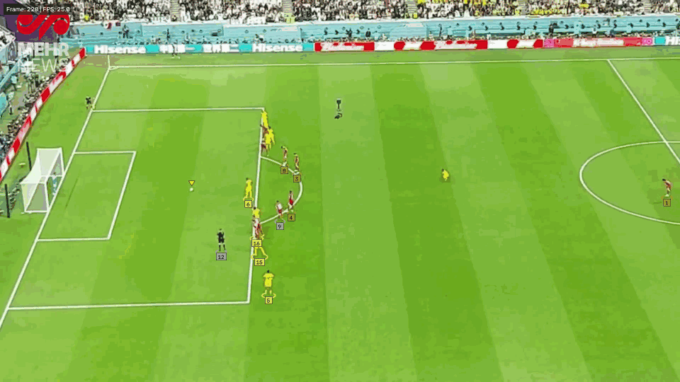
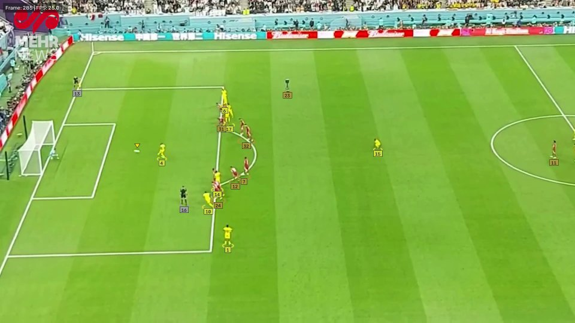
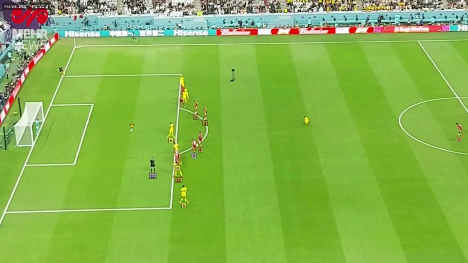
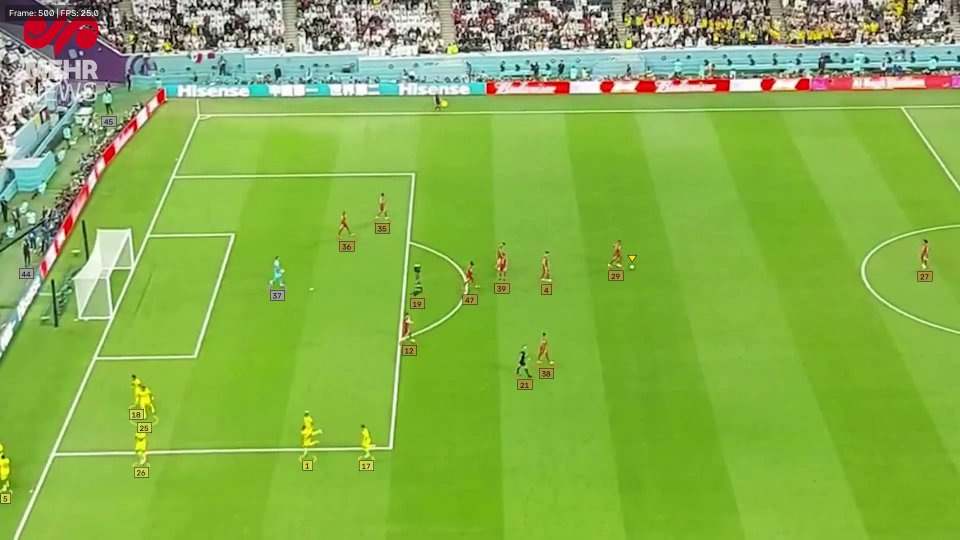

# futbol-cv

[](LICENSE)

Futbol maç videolarında oyuncu ve top tespiti, kalıcı ID takibi ve forma rengine göre takım sınıflandırması yapan iki geçişli Python komut satırı aracı.



> **Demo görüntü atfı:** *[2022 FIFA World Cup's first goal by Enner Valencia of Ecuador against Qatar](https://commons.wikimedia.org/wiki/File:2022_FIFA_World_Cup%27s_first_goal_by_Enner_Valencia_of_Ecuador_against_Qatar.webm)* — Yazar: **Mehr News Agency** ([mehrnews.com](https://www.mehrnews.com)), Lisans: [CC BY 4.0](https://creativecommons.org/licenses/by/4.0/). **Değiştirildi: tespit/takip katmanları eklendi (`configs/football.yaml` / `football_yolo11s.pt`).**

---

## Özellikler

- **Oyuncu ve top tespiti:** Ultralytics YOLO11 (`yolo11s.pt`) ile ayrı oyuncu (`conf`) ve top (`ball_conf`) güven eşikleri; `device: "auto"` (CUDA varsa GPU, yoksa CPU).
- **Kalıcı oyuncu takibi:** `supervision` ByteTrack sarmalayıcısı; `frame_rate` değeri otomatik olarak videonun etkin FPS'inden (`fps / stride`) alınır.
- **Top takibi ve enterpolasyon:** Çoklu top adayında önceki konuma yakınlık + kare başına sıçrama sınırı (`max_jump_px × geçen_kare`); kısa kopukluklarda (`<= max_gap_frames`) doğrusal enterpolasyon.
- **Forma rengine göre takım sınıflandırma:** Üst gövde kırpımından yeşil çim pikselleri (`exclude_grass`) elenerek CIE Lab ortalama renk çıkarılır; ilk `n_init_frames` karede KMeans (`k=2`) eğitilir, `tracker_id` başına kayan pencere çoğunluk oyu uygulanır, küme merkezlerinden uzak hakem/kaleciler `-1` olarak etiketlenir.
- **Sahne kesmesi algılama:** Ardışık karelerde HSV histogram Bhattacharyya mesafesi eşiği aştığında oyuncu takibi, top takibi ve takım oy geçmişi sıfırlanır; top enterpolasyonu kesme sınırını aşmaz.
- **Bellek dostu iki geçişli akış:** İlk geçişte yalnızca kutular ve takip sonuçları tutulur (kareler RAM'de biriktirilmez); ikinci geçişte video yeniden okunarak çizim yapılır.
- **Yapılandırılmış çıktılar:** İşaretlenmiş MP4 (`annotated.mp4`), kare-kare tespit tablosu (`tracks.csv`) ve koşu özeti (`summary.json`).

---

## Mimari

```text
Girdi Video (.mp4 / .webm)
   │
   ├─► Isınma Ön Geçişi (ilk n_init_frames kare)
   │      YOLO11 tespit (önbelleğe alınır) ─► TeamClassifier.add_init_frame ─► KMeans(k=2) fit
   │
   ├─► Geçiş 1 — Tespit & Takip (tüm kareler)
   │      VideoReader ─► Sahne kesmesi (HSV Bhattacharyya) ─► kesmede tracker/ball/team reset
   │                 ─► Detector (YOLO11) ─► PlayerTracker (ByteTrack) ─► TeamClassifier.predict
   │                                      ─► BallTracker.update
   │                 ─► Kesme segmentlerine göre BallTracker.interpolate
   │
   └─► Geçiş 2 — Çizim & Dışa Aktarım
          VideoReader ─► Annotator (elips + ID rozeti + top üçgeni + HUD) ─► annotated.mp4
                      ─► Exporter ─► tracks.csv + summary.json
```

Proje `src/` yerleşimini kullanır:

- `src/futbolcv/config.py` — YAML yükleme ve tip/aralık doğrulaması (`configs/default.yaml`, `configs/fast.yaml`, `configs/football.yaml`)
- `src/futbolcv/video_io.py` — Yeniden yinelenebilir `VideoReader` ve bağlam yöneticili `VideoWriter`
- `src/futbolcv/detector.py` — YOLO11 sarmalayıcısı (`models/` çözümlemesi, cihaz seçimi)
- `src/futbolcv/tracker.py` — `PlayerTracker` (`sv.ByteTrack` sarmalayıcısı)
- `src/futbolcv/ball.py` — `BallTracker` (aday seçimi, sıçrama filtresi, doğrusal enterpolasyon)
- `src/futbolcv/team.py` — `TeamClassifier` (çim maskeli gövde rengi, KMeans, çoğunluk oyu)
- `src/futbolcv/annotate.py` — `Annotator` (forma tonu canlılaştırma, parlaklığa duyarlı metin, dolu/boş top üçgeni)
- `src/futbolcv/export.py` — `tracks.csv` ve `summary.json` dışa aktarıcı
- `src/futbolcv/pipeline.py` & `src/futbolcv/cli.py` — İki geçişli orkestrasyon ve CLI

---

## Kurulum (Windows)

Gereksinimler: **Python 3.11** (`.python-version`) ve [uv](https://docs.astral.sh/uv/).

```powershell
git clone <repo-url>
cd futbol-cv

uv venv --python 3.11 .venv
.\.venv\Scripts\Activate.ps1

# Geliştirme ve test araçları dahil kurulum (önerilen)
uv pip install -r requirements-dev.txt -e .

# Yalnızca çalışma zamanı bağımlılıkları için:
# uv pip install -r requirements.txt -e .
```

TLS/sertifika hatası alırsanız sistem sertifikalarıyla kurun:

```powershell
uv pip install --system-certs -r requirements-dev.txt -e .
```

> **Önemli — Çalışma Dizini (CWD):** Tüm komutları **repo kök dizininden** (`futbol-cv/`) çalıştırın. `configs/default.yaml` içindeki yalın ağırlık adı (`yolo11s.pt`) çalışma dizinine göre `models/yolo11s.pt` olarak çözülür.

### Opsiyonel: NVIDIA GPU (CUDA) Kurulumu

`requirements.txt` bilinçli olarak `torch` içermez (`ultralytics` varsayılan olarak CPU sürümünü kurar). NVIDIA GPU kullanmak için [PyTorch yerel kurulum seçicisinden](https://pytorch.org/get-started/locally/) işletim sisteminize ve CUDA sürümünüze uygun `--index-url` değerini alın ve şu biçimde çalıştırın:

```powershell
uv pip install --reinstall torch torchvision --index-url <pytorch-cuda-index-url>
```

`detector.device: "auto"` CUDA kullanılabilir olduğunda otomatik olarak GPU (`0`), aksi halde CPU seçer.

### TLS / Sertifika Hatasında Model Ağırlığını Elle İndirme

Kurumsal proxy veya özel kök sertifika bulunan Windows ortamlarında Ultralytics otomatik ağırlık indirmesi `SSLCertVerificationError` / bağlantı hatası verebilir. Bu durumda ağırlığı Windows yerel TLS yığınıyla (`curl.exe`) doğrudan `models/` altına indirip tekrar çalıştırın:

```powershell
curl.exe -fL https://github.com/ultralytics/assets/releases/download/v8.4.0/yolo11s.pt -o models\yolo11s.pt
```

---

## Kullanım

Komut satırı seçeneklerini görmek için:

```powershell
python -m futbolcv --help
```

### 1. Varsayılan Ayar (`imgsz: 1280` — yüksek doğruluk)

Küçük top ve uzak oyuncular için `configs/default.yaml` `imgsz: 1280` kullanır (GPU için uygundur; CPU'da yavaştır):

```powershell
python -m futbolcv --input data\mac.mp4 --output outputs\run1 --config configs\default.yaml
```

### 2. Fine-Tune Futbol Modeli (`configs/football.yaml`)

Özel eğitilmiş 4 sınıflı futbol modeli (`ball`, `goalkeeper`, `player`, `referee`) ile çalıştırmak için ağırlığı GitHub Release sayfasından indirip `models/football_yolo11s.pt` konumuna koyun (ağırlık dosyası repoda tutulmaz):

```powershell
curl.exe -fL https://github.com/<GITHUB_USER>/<REPO_NAME>/releases/latest/download/football_yolo11s.pt -o models\football_yolo11s.pt
python -m futbolcv --input data\mac.mp4 --output outputs\football --config configs\football.yaml
```

Bu profilde hakem tespitleri (`referee_class_ids: [3]`) oyuncularla birlikte takip edilir, KMeans eğitimine sokulmaz ve forma renginden bağımsız olarak doğrudan `-1` (gri) etiketlenir.

### 3. Hızlı CPU Önizleme (`configs/fast.yaml`, `imgsz: 640`)

CPU üzerinde hızlı deneme yapmak için `imgsz: 640` kullanan `configs/fast.yaml` (~2.6× daha hızlı) ve/veya `--max-frames` seçeneğini kullanın:

```powershell
python -m futbolcv --input data\mac.mp4 --output outputs\preview --config configs\fast.yaml --max-frames 300
```

Cihazı geçersiz kılmak için `--device cpu` veya `--device 0` verilebilir. Daha uzun videolarda `output.stride: 2` ayarlanarak her 2. kare işlenebilir.

### 4. Demo GIF Üretme

İşaretlenmiş çıktı videosundan ≤10 MiB boyutunda bir GIF üretmek için:

```powershell
python scripts\make_demo_gif.py --input outputs\football\annotated.mp4 --output docs\assets\demo.gif --start 8.8 --duration 7.2 --width 960 --fps 10
```

### 5. Testler ve Kod Kalitesi

```powershell
# Hızlı birim testleri (GPU, internet ve model ağırlığı gerektirmez)
pytest -q

# Gerçek yolo11s.pt ağırlığıyla entegrasyon testi (models/yolo11s.pt gerekir)
pytest -m slow -v

# Lint ve biçim kontrolü
ruff check .
ruff format --check .
```

---

## Çıktı Formatı

Her çalıştırma `--output` klasöründe üç dosya üretir:

1. **`annotated.mp4`** — Oyuncu ayak altı takım elipsleri, ID rozetleri (`-1` nötr gri), top üçgeni (algılanan dolu, enterpole içi boş) ve sol üstte kare/FPS bilgisi.
2. **`tracks.csv`** — Kare bazında tüm oyuncu ve top kayıtları:
   ```text
   frame,track_id,team_id,x1,y1,x2,y2,conf,kind,interpolated
   ```
   Top satırlarında `track_id` ve `team_id` boştur; `kind` alanı `player` veya `ball` değerini alır.
3. **`summary.json`** — Video metadatası, benzersiz oyuncu ID sayıları (`player_ids_by_team`), top tespit/enterpolasyon oranları ve aşama süreleri (`elapsed_sec`, `model_load_sec`, `pass1_sec`, `pass1_fps`, `pass2_sec`).

---

## Futbol Veri Setiyle Fine-Tune (Colab GPU)

[](https://colab.research.google.com/github/<GITHUB_USER>/<REPO_NAME>/blob/main/notebooks/finetune_colab.ipynb)

Hazır COCO `yolo11s.pt` modeli geniş yayın açısında küçük topu sık kaçırdığı için `notebooks/finetune_colab.ipynb` (ve yerel/sunucu karşılığı `scripts/train.py`) ile Google Colab ücretsiz T4 GPU üzerinde ince ayar (fine-tune) yapılmıştır.

- **Veri seti:** [Roboflow Universe — Football Players Detection (`roboflow-jvuqo/football-players-detection-3zvbc`, v1)](https://universe.roboflow.com/roboflow-jvuqo/football-players-detection-3zvbc) — Lisans: [CC BY 4.0](https://creativecommons.org/licenses/by/4.0/)
- **Sınıflar (4):** `0: ball`, `1: goalkeeper`, `2: player`, `3: referee`
- **Veri sızıntısı notu:** Değerlendirmede kullanılan Ekvador–Katar klibi (2022 Dünya Kupası) eğitim/doğrulama/test setinde yer almaz.
- **Eğitim parametreleri:** Taban `yolo11s.pt`, `imgsz=1280`, `epochs=50`, `batch=8`, `patience=15`, `seed=42`, `ultralytics==8.4.216` (Google Colab Tesla T4 GPU). Yerel GPU sunucusunda aynı eğitim:
  ```powershell
  python scripts\train.py --data path\to\data.yaml --epochs 50 --imgsz 1280 --batch 8 --device auto
  ```
- **Eğitilmiş ağırlık:** Repoda ağırlık dosyası bulunmaz. İndirmek için yukarıdaki **Fine-Tune Futbol Modeli** adımındaki GitHub Release bağlantısını kullanın (`models/football_yolo11s.pt`).

### Değerlendirme Metrikleri (`test` split)

| Sınıf | `AP50` / `mAP50` | `AP50-95` / `mAP50-95` |
|---|---:|---:|
| **Genel (`overall`)** | **0.8627** | **0.6513** |
| `player` (`2`) | 0.9906 | 0.8168 |
| `referee` (`3`) | 0.9709 | 0.7149 |
| `goalkeeper` (`1`) | 0.9575 | 0.8067 |
| `ball` (`0`) | 0.5319 | 0.2667 |

*`test` split genel Precision: `0.8559`, Recall: `0.8494`. (Karşılaştırma için erken durdurma ve `best.pt` seçiminde kullanılan `val` split genel değerleri: `mAP50=0.8781`, `mAP50-95=0.6721`, `ball AP50=0.5616`.)*

---

## Sonuçlar ve Performans

Ölçümler 1920×1080, 25 fps açık lisanslı Ekvador–Katar yayın klibi üzerinde (`stride=1`) yapılmıştır.

### Hız Kıyaslaması (`--max-frames 300`, CPU)

| Donanım | Yapılandırma | `imgsz` | `pass1_fps` | `pass1` (sn) | `pass2` (sn) | Toplam (sn) |
|---|---|---:|---:|---:|---:|---:|
| CPU — `11th Gen Intel(R) Core(TM) i7-11370H @ 3.30GHz` (4C/8T, 15.7 GB RAM) | `configs/fast.yaml` (COCO) | 640 | **6.28** *(2 koşu ort.)* | 47.8 | 6.6 | 54.6 |
| CPU — `11th Gen Intel(R) Core(TM) i7-11370H @ 3.30GHz` (4C/8T, 15.7 GB RAM) | `configs/default.yaml` (COCO) | 1280 | **2.38** *(2 koşu ort.)* | 126.5 | 6.3 | 133.0 |
| CPU — `11th Gen Intel(R) Core(TM) i7-11370H @ 3.30GHz` (4C/8T, 15.7 GB RAM) | `configs/football.yaml` (fine-tune) | 1280 | **2.45** *(300 kare)* | 122.6 | 6.0 | 128.9 |
| GPU (CUDA) | `configs/default.yaml` / `football.yaml` | 1280 | Ölçülmedi | Ölçülmedi | Ölçülmedi | Ölçülmedi |

*Not: `640` hızlı önizleme için uygundur ancak geniş yayın açısında uzak oyuncuları ve topu daha sık kaçırır.*

### COCO (`default.yaml`) vs. Fine-Tune Futbol (`football.yaml`) — Tam Klip (`543` kare / `21.72 sn`)

| Metrik | COCO (`configs/default.yaml`) | Fine-Tune (`configs/football.yaml`) | Yorum |
|---|---:|---:|---|
| **Gerçek top (takipçi çıktısı, nokta dışı — ham / görünür)** | `39.6%` / `59.5%` (`215` / `323`) | **`75.3%` / `78.8%`** (`409` / `428`) | Penaltı hazırlığı (`276/276`) + şut uçuşu + orta saha (`103/113`); sabit-nokta kilidi önleme (`BallTracker`) ile orta saha gerçek top takibi `20 → 103/113` kareye çıktı (COCO'da 0 regresyon). |
| `ball.detected_ratio` | `40.9%` (`222/543`) | `96.5%` (`524/543`) *(penaltı noktası yanlış pozitifi dahil)* | Top ağların içindeyken (`f=300–429`) tek aday kalan boyalı penaltı noktası ham orana dahildir (bkz. Bilinen Kısıtlar). |
| `ball.visible_ratio` (enterpolasyon dahil) | `63.0%` (`342/543`) | `100.0%` (`543/543`) *(penaltı noktası yanlış pozitifi dahil)* | 15 karelik doğrusal enterpolasyon sonrası oran; `f=300–429` arasındaki tek-aday penaltı noktası karelerini de içerir. |
| `unique_player_ids` | `48` | `64` | Ortalama oyuncu tespiti `13.3 → 19.1 / kare` arttı ve saha dışı fotoğrafçılar elendi; ancak ID parçalanması da arttı — ByteTrack eşikleri COCO modeline göre ayarlandı, fine-tune model için yeniden ayarlanmadı. |
| `player_ids_by_team["-1"]` | `9` | `16` | Açık `referee` sınıfı (`referee_class_ids: [3]`) renk eşiğine gerek kalmadan anında `-1` etiketlenir. |
| `pass1_fps` (`--max-frames 300`, CPU) | `2.38` | `2.45` | Aynı mimari (`yolo11s`, `imgsz 1280`); hız eşdeğer (fark ölçüm gürültüsü içinde). |

| Fine-tune penaltı şutu havada (Kare 285) | COCO penaltı anı (Kare 200) | COCO orta saha & kısıt örneği (Kare 500) |
|---|---|---|
|  |  |  |
| Fine-tune model hareket bulanıklığındaki topu şut anında havada yakalıyor; orta (`16`) ve yan (`13`) hakem `-1` (gri), saha dışı fotoğrafçı yok. | COCO `default.yaml`: penaltı noktasında top işaretli; siyah hakem `12` gri (`-1`), ancak çömelen oyuncu kaçırılmış. | COCO `default.yaml`: saha dışı görevliler (`44`, `45`) tespit edilmiş ve ID değişimi sonrası hakem (`21`) oy penceresi gecikmesi yaşıyor. |

---

## Bilinen Kısıtlar

1. **Örtüşmede ID değişimi ve takım etiketi gecikmesi:** ByteTrack yalnızca hareket (Kalman) ve IoU kullandığından ceza sahası kalabalığında ID değişimleri oluşur (22 oyuncu yerine 543 karede COCO'da 48, fine-tune modelde 64 benzersiz ID). Bir oyuncu veya (COCO modunda) hakem başka birinin ID'sini devraldığında kayan çoğunluk oyu penceresi (`vote_window: 15`) eski takımı birkaç kare taşır — **ID değişiminde takım etiketi birkaç kare gecikmeli düzelir** (ör. COCO Kare 500'de siyah formalı hakem `21` geçici olarak bordo rozet taşıyor; `football.yaml` modelinde hakem `referee` sınıfıyla tespit edildiği karelerde anında `-1` olur, ancak hakem nadiren `player` sınıfıyla algılandığında aynı gecikme görülebilir).
2. **Boyalı penaltı noktası yanlış pozitifi (fine-tune — kısmen çözüldü):** `BallTracker` içine eklenen sabit nokta hafızası ve yeniden kilitlenme (`reacquire_conf`) kuralı, orta sahada hareketli gerçek top belirdiği anda (`f=430–542`) penaltı noktası kilidini kırarak o bölümdeki kilitli kareleri **`90 → 10` (`-89%`)** indirdi ve gerçek orta saha top takibini **`20 → 103/113`** kareye çıkardı. Ancak top ağların içinde/kalecinin elinde tamamen görünmezken (`f=300–429`) sahada başka hareketli aday kalmadığı için duran top/penaltı hazırlığını koruyan geri-düşüş kuralı bu aralıkta (~105 kare) boyalı penaltı noktasını seçmeye devam eder; kökten çözüm için eğitim setine boş penaltı noktası negatif örnekleri eklenmelidir.
3. **Hazır COCO modeliyle top tespiti:** `yolo11s.pt` futbol özelinde eğitilmediğinden hızlı şut ve hareket bulanıklığında topu kaçırır (`%40.9` ham tespit, enterpolasyonla `%63.0`).
4. **Saha dışı tespitler ve tripod:** Fine-tune model kenardaki fotoğrafçıları büyük ölçüde elese de her iki modelde saha üstündeki kamera tripodu bazı açılarda `person`/`player` olarak yakalanabiliyor.
5. **Sahne kesmesi algılama:** Test klibi tek kesintisiz kamera çekimi olduğu için `scene_cut_threshold: 0.4` yalnızca normal kamera panında yanlış pozitif üretmediği (`max=0.069`) yönünde test edildi; **kesme algılama sentetik testle doğrulandı, gerçek kesme içeren klipte doğrulanmadı.**
6. **CPU hızı:** `imgsz: 1280` CPU'da ~2.4 fps'tir (uzun videolarda ısınma/arka plan yüküyle değişebilir). CPU'da hızlı önizleme için `configs/fast.yaml`, `--max-frames` veya `output.stride: 2` kullanın.

---

## Sonraki Adımlar (Future Work)

- `supervision 0.30.x`'te deprecated olan `sv.ByteTrack` yerine Roboflow `trackers` paketine geçiş
- Daha geniş/çeşitli futbol veri setiyle (`ball` AP50'yi artırmak için) fine-tune ve boş penaltı noktası negatif örnekleri ekleme
- Fine-tune modelin yüksek oyuncu tespit yoğunluğuna göre ByteTrack eşiklerini yeniden kalibre etme
- Saha anahtar noktalarıyla homografi ve 2D kuşbakışı taktik radar
- Saha maskesiyle tripod/kenar görevli filtreleme ve Re-ID öznitelikleriyle ID değişimi azaltma
- Oyuncu hızı, kat edilen mesafe, top sahipliği yüzdesi ve Streamlit etkileşimli arayüzü

---

## Lisans ve Atıflar

- **Kod lisansı:** [GNU AGPL-3.0](LICENSE) — Ultralytics YOLO AGPL-3.0 lisanslı olduğu için proje kodu da GNU AGPL-3.0 altında lisanslanmıştır.
- **Eğitim veri seti atfı (fine-tune):**
  - Veri seti: *[Football Players Detection (`roboflow-jvuqo/football-players-detection-3zvbc`, v1)](https://universe.roboflow.com/roboflow-jvuqo/football-players-detection-3zvbc)* (Roboflow Universe)
  - Lisans: [Creative Commons Attribution 4.0 International (CC BY 4.0)](https://creativecommons.org/licenses/by/4.0/)
- **Demo görselleri ve GIF kaynağı:**
  - Başlık: *[2022 FIFA World Cup's first goal by Enner Valencia of Ecuador against Qatar](https://commons.wikimedia.org/wiki/File:2022_FIFA_World_Cup%27s_first_goal_by_Enner_Valencia_of_Ecuador_against_Qatar.webm)*
  - Yazar: **Mehr News Agency** ([mehrnews.com](https://www.mehrnews.com))
  - Lisans: [Creative Commons Attribution 4.0 International (CC BY 4.0)](https://creativecommons.org/licenses/by/4.0/)
  - Değişiklik bildirimi: **Değiştirildi: tespit/takip katmanları eklendi** (kırpılmış/ölçeklenmiş kareler üzerine YOLO11, ByteTrack ve takım katmanları çizilmiştir).
- **Üçüncü parti kütüphaneler:** [Ultralytics YOLO11](https://github.com/ultralytics/ultralytics), [Roboflow Supervision](https://github.com/roboflow/supervision), OpenCV, scikit-learn, NumPy, Pillow.
