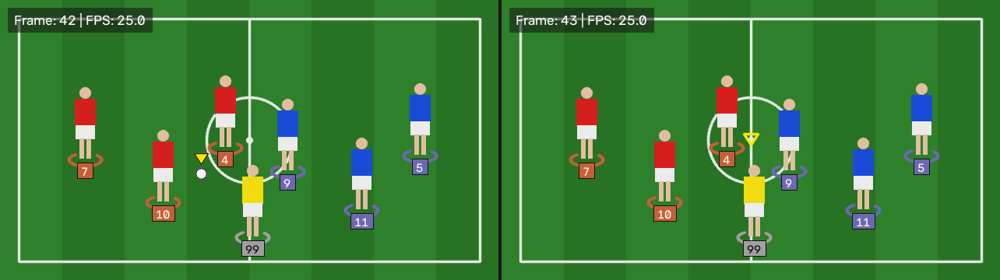

# HANDOFF (Geliştirici → İnceleyici)

## Görev: T08 — Annotator

**Değişen/eklenen dosyalar**
- `configs/default.yaml` — `annotate.use_jersey_colors: true` eklendi (REVIEW.md önerisi).
- `src/futbolcv/config.py` — `AnnotateConfig.use_jersey_colors: bool = True` alanı ve boolean doğrulaması eklendi.
- `src/futbolcv/annotate.py` — `centers_to_bgr` (Lab/HSV küme merkezlerini BGR'ye çevirir) ve `Annotator` sınıfı (`annotate(frame, result, *, fps=None) -> np.ndarray`, `set_team_colors_from_centers`) eklendi; oyuncu ayak altı elips + kontrast uyarlamalı ID etiketi (takım rengi / `-1` gri), top üçgen işaretçisi (gerçek tespit: içi dolu, enterpole: içi boş), sol üst yarı saydam kare no/FPS HUD'ı; girdi kareyi değiştirmez.
- `tests/test_config.py` — `annotate.use_jersey_colors` geçersiz tip doğrulama durumu eklendi.
- `tests/test_annotate.py` — çıktı şekil/dtype ve girdi değişmezliği, boş tespit / eksik top, dolu vs içi boş top üçgeni piksel farkı, `-1` / eksik metadata gri renk, `centers_to_bgr` ve `use_jersey_colors` aç/kapa testleri (5 test) eklendi.
- `docs/assets/t08_annotator_preview.png` — gerçek `TeamClassifier` + `Annotator` ile üretilmiş görsel kontrol çıktısı (sol: tespit edilen top — içi dolu üçgen, sağ: enterpole top — içi boş üçgen, takım renkli elips/ID etiketleri, `-1` gri hakem, HUD).
- `docs/PLAN.md` — T08 durumu `REVIEW` olarak güncellendi.

**Görsel kontrol**


**Çalıştırılan komutlar ve sonuçları**
```
.venv\Scripts\pytest.exe -q
-> ........................................................................ [ 88%]
-> .........                                                                [100%]
-> 81 passed, 1 deselected in 16.63s

.venv\Scripts\ruff.exe check .
-> All checks passed!

.venv\Scripts\ruff.exe format --check .
-> 23 files already formatted

git commit -m "feat: frame annotator with jersey colors and ball markers (T08)"
-> Commit atıldı (push edilmedi).
```

**Kabul kriterleri**
- [x] Oyuncu: ayak altına elips + ID etiketi, takım rengine göre; `-1` gri.
- [x] Top: üçgen işaretçi; gerçek tespit içi dolu + ince kenarlı, enterpole (`interpolated=True`) içi boş üçgen (birim testiyle iç merkez pikselinden doğrulandı).
- [x] Sol üstte yarı saydam kare no / FPS HUD'ı (`show_hud=True`).
- [x] Girdi kareyi değiştirmez (kopya döner), aynı şekil ve `dtype` korunur, boş tespitlerde / eksik topta çökmez.
- [x] Görsel kontrol ekran görüntüsü `docs/assets/t08_annotator_preview.png` olarak üretildi ve incelendi.
- [x] `pytest -q`, `ruff check .`, `ruff format --check .` temiz; GPU/internet/ağırlık gerektirmiyor.
- [x] Görev sonu commit'i (`feat: frame annotator with jersey colors and ball markers (T08)`) atıldı (push edilmedi).

**Sapmalar** (plandan farklı yapılanlar + gerekçe)
- REVIEW.md'deki opsiyonel öneri uygulandı: `annotate.use_jersey_colors: true` ve `centers_to_bgr` / `set_team_colors_from_centers` eklendi; `TeamClassifier.cluster_centers` verildiğinde elips/rozet renkleri gerçek forma renginden (Lab/HSV → BGR) otomatik türetilir, aksi halde config'teki sabit BGR renkleri kullanılır.
- Açık renkli formalarda (beyaz/sarı) beyaz ID yazısının kaybolmaması için rozet arka plan parlaklığına göre otomatik koyu/açık metin rengi seçimi eklendi (`_text_color_for_bg`).

**Açık sorular / riskler**
- Yok.
