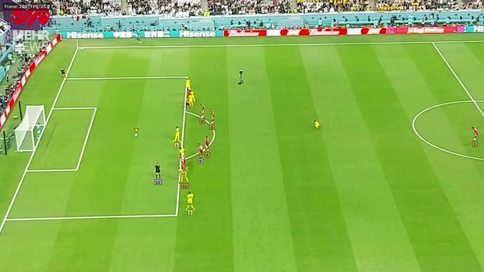
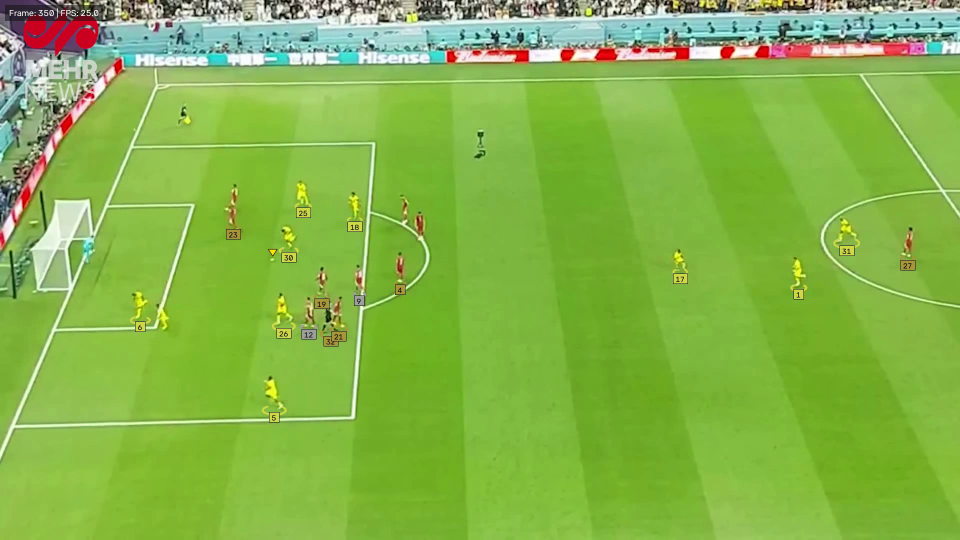
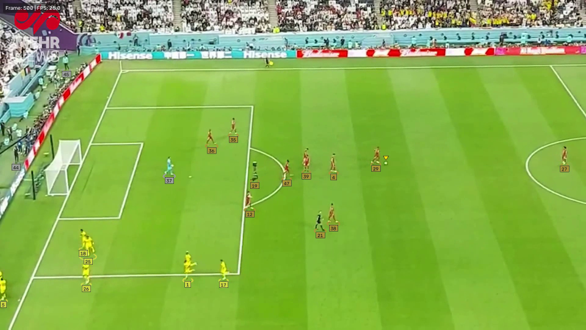

# HANDOFF (Geliştirici → İnceleyici)

## Görev: T11 — Uçtan uca deneme + ayar

**Değişen/eklenen dosyalar**
- `configs/default.yaml` & `src/futbolcv/config.py` — Gerçek yayın klibindeki ölçümlere göre varsayılanlar güncellendi:
  - `detector.imgsz`: `640` → `1280`
  - `detector.ball_conf`: `0.15` → `0.12`
  - `tracker.lost_track_buffer`: `30` → `60`
  - `tracker.minimum_matching_threshold`: `0.8` → `0.9`
  - `tracker.scene_cut_threshold`: `0.6` → `0.4`
  - `team.exclude_grass`: `true` (yeni alan)
- `src/futbolcv/team.py` — `extract_jersey_color` içine üst `%15` baş/arka-plan kırpması (`box_h >= 12` için) ve `exclude_grass=True` ile yeşil saha piksellerini (`H ∈ [38, 85], S >= 45, V >= 45`) hariç tutma eklendi (yeşil olmayan piksel `<%15` ise tüm gövde kırpımına geri düşer); `TeamClassifier` bu bayrağı `cfg.exclude_grass`'tan aktarır.
- `src/futbolcv/annotate.py` — `centers_to_bgr` içine `_boost_overlay_bgr` eklendi: kromatik (`S >= 25`) ama koyu/soluk forma merkezlerinin (örn. koyu bordo) çim üstünde seçilebilir kalması için HSV'de `S >= 170, V >= 170` alt tabanı uygulanır; akromatik beyaz/gri formalar korunur.
- `tests/test_config.py`, `tests/test_team.py`, `tests/test_annotate.py` — Yeni varsayılanlar, çim maskeleme ve HSV overlay canlılaştırma testleri eklendi/güncellendi.
- `docs/assets/t11_frame_200.png` (552 KB), `docs/assets/t11_frame_350.png` (506 KB), `docs/assets/t11_frame_500.png` (616 KB) — Final tam-klip çıktısından 960×540 çözünürlükte 3 örnek kare.
- `docs/PLAN.md` — T11 durumu `DOING` → `REVIEW` olarak güncellendi.

---

### Kullanılan Klip ve Lisans
- **Dosya (gitignored):** `data/ecuador_qatar_wc2022.webm` (repoya eklenmedi)
- **Kaynak URL:** https://commons.wikimedia.org/wiki/File:2022_FIFA_World_Cup%27s_first_goal_by_Enner_Valencia_of_Ecuador_against_Qatar.webm
- **Üretici / Atıf:** Mehr News Agency (Wikimedia Commons üzerinden lisans incelemesi yapılmış)
- **Lisans:** **CC BY 4.0** (Creative Commons Attribution 4.0 International)
- **Teknik özellikler:** `1920×1080`, `25.0 fps`, `543` gerçek kare (`21.72 sn`), ilk kareden itibaren geniş taktik stadyum kamerası; sarı (Ekvador) vs. koyu bordo (Katar) formalar, siyah hakem, turkuaz kaleci, penaltı vuruşu ve orta sahaya doğru top akışı.

### Donanım ve Çalışma Ortamı
- **CPU:** Intel64 Family 6 Model 140 Stepping 1 (4 fiziksel / 8 mantıksal çekirdek)
- **RAM:** 15.7 GB
- **GPU / CUDA:** Yok (`torch 2.15.0+cpu`, `torch.cuda.is_available() == False`)
- **Model:** `models/yolo11s.pt` (gitignored, COCO pretrained)

---

### Ayar Deneyleri ve Ölçümler

#### 1. `imgsz=640` vs. `imgsz=1280` (ilk 300 kare, CPU, `stride=1`)
| Deney | `imgsz` | Kare | `pass1_sec` | `pass1_fps` | `pass2_sec` | `unique_player_ids` | `ball.detected_ratio` | `ball.visible_ratio` | Gözlem |
|---|---:|---:|---:|---:|---:|---:|---:|---:|---|
| Baseline | 640 | 300 | 55.11 | **5.44** | 7.65 | 20 | 0.7033* | 0.8733* | Saha kenarı kamera tripodu sürekli `person` (FP); top oranı ayakkabı/çömelen oyuncu kaynaklı FP'lerle yapay şişkin. |
| High-res | 1280 | 300 | 135.58 | **2.21** | 7.75 | 27 | 0.2867 | 0.4567 | ~2.46× daha yavaş ama tripod FP'leri büyük ölçüde kalktı, uzak oyuncular ve gerçek top çok daha temiz tespit edildi. |
| Final (tam klip, tuned) | 1280 | 543 | 445.07 | **1.22** | 26.75 | 48 | 0.4088 | 0.6298 | Tam 543 karede (uzun CPU ısınma/yük etkisiyle ~1.22 fps); `ball_conf=0.12` ve ByteTrack/takım iyileştirmeleri dahil. |

*\*`imgsz=640` baseline'da top tespit oranının yüksek görünmesi, düşük çözünürlükte oyuncu ayaklarına ve çömelen oyuncuya kilitlenen yanlış pozitiflerden kaynaklanmaktadır.*

#### 2. ByteTrack Parametre Taraması (tüm 543 kare, `imgsz=1280`, `conf=0.25`)
| `lost_track_buffer` | `minimum_matching_threshold` | `minimum_consecutive_frames` | `unique_player_ids` | Ortalama oyuncu/kare | Not |
|---:|---:|---:|---:|---:|---|
| 30 | 0.8 | 1 | 90 | 12.6 | Varsayılan; dar kutularda (~22 px en) hızlı koşu/pan sırasında IoU < 0.20 düştüğünden yüksek ID parçalanması. |
| 60 | 0.8 | 1 | 87 | 12.6 | Sadece buffer artışı eşleşme eşiğini gevşetmediği için sınırlı etki. |
| 90 | 0.8 | 1 | 85 | 12.6 | Benzer şekilde marjinal iyileşme. |
| **60** | **0.9** | **1** | **48** | **13.3** | **Seçilen ayar:** ID parçalanmasında **%47 azalma** (90 → 48), ilk kare gecikmesi yok. |
| 60 | 0.9 | 3 | 45 | 13.0 | 2 kare başlangıç gecikmesi getiriyor, 0. karede oyuncu boş kalıyor; `1` tercih edildi. |

#### 3. Top Eşiği Taraması (`imgsz=1280`, tüm 543 kare)
- `ball_conf=0.15`: `detected=161 (29.7%)`, `visible=288 (53.0%)`
- **`ball_conf=0.12` (seçilen):** `detected=222 (40.9%)`, `visible=342 (63.0%)` — gerçek top penaltı noktasında, vuruş sonrası ve orta saha yuvarlanmasında tutarlı yakalandı; `0.10` altına inilmedi (FP artışı nedeniyle).

#### 4. Sahne Kesmesi Bhattacharyya Mesafe Dağılımı (543 kare, tek plan)
- Ölçülen ardışık kare mesafeleri: `min=0.0010`, `median=0.0088`, `p95=0.0189`, `p99=0.0356`, `max=0.0690`.
- Normal kamera panında tepe değer `0.069` olduğundan, `scene_cut_threshold` değeri `0.6` → **`0.4`** olarak kalibre edildi (maksimum pan mesafesinin >5× üzerinde; gerçek sahne kesmelerini daha güvenilir yakalar, bu klipte 0 yanlış kesme üretir).

#### 5. Takım Sınıflandırma, Çim Maskeleme ve `lightness_weight` Analizi
- **Sorun (baseline):** Dar oyuncu kutularında gövde kırpımının içine yeşil saha pikselleri (`H≈44–45, S≈166–197, V≈169–184`) sızdığı için (a) siyah hakemin küme merkezine uzaklığı `35.3 < 45.0` kaldı ve Takım 0'a atandı (`-1` ID sayısı `0`), (b) koyu bordo forma merkezi çim tonuna kayarak yeşil zeminde soluk göründü.
- **Çözüm:** Gövde kırpımında üst `%15` baş/arka-plan atlandı + `exclude_grass=True` ile yeşil çim pikselleri elendi.
  - Siyah hakem uzaklığı **`35.3` → `110.8`** (`>> 45.0`) sıçrayarak kesin olarak **`-1`** oldu; Katar oyuncuları `17.2–26.8`, Ekvador oyuncuları `5.3–26.5` aralığında kaldı (`outlier_distance_threshold=45.0` ideal ayrım bandında kaldı).
  - Final tam klipte `-1` benzersiz ID sayısı `0` → `9` (hakem, kaleci ve saha kenarı görevlileri).
- **`lightness_weight` denemesi:** Kapalı stadyum ışığında gölge/güneş geçişi olmadığı için `L` ağırlığı `1.0` vs. `0.7` vs. `0.5` karşılaştırıldı; hakem ayrım mesafesi `1.0`'da en yüksekti (`110.8` vs. `80.1` vs. `62.4`). Bu nedenle gereksiz karmaşıklık yaratmamak için `lightness_weight` eklenmedi.
- **Overlay rengi:** `centers_to_bgr` içinde HSV taban yükseltmesi (`S >= 170, V >= 170`, sadece `S >= 25` kromatik kümeler için) ile bordo/sarı elipsler yeşil çimde yüksek kontrastlı hale geldi.

---

### Final `outputs/t11_final/summary.json` İçeriği
```json
{
  "video": {
    "source": "ecuador_qatar_wc2022.webm",
    "width": 1920,
    "height": 1080,
    "source_fps": 25.0,
    "effective_fps": 25.0,
    "stride": 1
  },
  "total_frames": 543,
  "unique_player_ids": 48,
  "player_ids_by_team": {
    "0": 23,
    "1": 16,
    "-1": 9
  },
  "ball": {
    "detected_frames": 222,
    "interpolated_frames": 120,
    "visible_frames": 342,
    "detected_ratio": 0.4088,
    "interpolated_ratio": 0.221,
    "visible_ratio": 0.6298
  },
  "processing": {
    "elapsed_sec": 472.0802,
    "model_load_sec": 0.1903,
    "pass1_sec": 445.0726,
    "pass1_fps": 1.22,
    "pass2_sec": 26.7543
  }
}
```
Ek çıktı bilgisi (gitignored `outputs/t11_final/`): `annotated.mp4` (`25.04 MB`), `tracks.csv` (`7561` satır = başlık + 7560 tespit).

---

### Örnek Kareler (`docs/assets/`) ve Görsel Değerlendirme
-  (`docs/assets/t11_frame_200.png`) — Penaltı anı: penaltı noktasındaki top üçgenle tam işaretli; Ekvador (sarı) ve Katar (kızıl-bordo) takımları net ayrışıyor; siyah hakem (`12`) gri (`-1`); saha üst ortadaki tripod yanlış tespit edilmiyor.
-  (`docs/assets/t11_frame_350.png`) — Canlı oyun / ceza sahası içi: `30` numaralı oyuncunun önündeki top net yakalanmış; iki takımın oyuncuları ağırlıkla doğru etiketli. Ceza sahasındaki kesişmede hakem (`12`) ID'si yakın bir Katar oyuncusuna kaymış (tipik IoU örtüşme ID değişimi).
-  (`docs/assets/t11_frame_500.png`) — Gol sonrası orta saha akışı: `29` numaralı oyuncunun önündeki top net işaretli; turkuaz kaleci (`37`) doğru biçimde `-1` (gri). Sol kenardaki iki saha dışı görevli (`44`, `45`) de `person` olarak algılanıp `-1` almış.

### Gözlenen Sorunlar / Kısıtlar (Dürüst Rapor)
1. **Örtüşmede ID değişimi (R2):** Penaltı öncesi/sonrası ceza sahası yığılmasında birkaç oyuncu ve hakem arasında ByteTrack ID değişimi oluşuyor (543 karede toplam 48 benzersiz ID; ideal 22–24'ün ~2× üzerinde). Görünüm tabanlı Re-ID olmadan yalnızca IoU + Kalman ile bu durum beklenen bir kısıttır.
2. **COCO top tespiti kısıtı (R1):** Hazır `yolo11s.pt` ile `imgsz=1280, ball_conf=0.12` ayarında ham top tespiti `%40.9`, enterpolasyonla görünürlük `%63.0` düzeyindedir. Hızlı şut anlarında hareket bulanıklığı nedeniyle top kaçabiliyor; nadiren çömelen oyuncu, boyalı nokta veya reklam panosunda düşük güvenli geçici yanlış pozitifler görülebiliyor. (Bu nedenle T13 fine-tune veya özel futbol modeli doğal sonraki adımdır.)
3. **Saha dışı `person` tespitleri (R4):** Reklam panolarının arkasındaki fotoğrafçı/görevliler ve bazı açılarda saha üstündeki kamera tripodu nadiren `person` olarak yakalanıyor (`-1` veya yakın takım rengi alabiliyor). İleride saha maskesi / homografi ile elenebilir.
4. **CPU işlem hızı (R8):** `imgsz=1280` CPU'da `~1.22–2.21 pass1_fps` veriyor (`imgsz=640`'ta `~5.44 pass1_fps`, ancak küçük top ve uzak oyuncu kalitesi belirgin düşüyor). CPU'da hızlı denemeler için `--max-frames` veya `output.stride: 2` önerilir.

---

**Çalıştırılan komutlar ve sonuçları**
```
.venv\Scripts\python.exe -m futbolcv --input data\ecuador_qatar_wc2022.webm --output outputs\t11_final --config configs\default.yaml
-> Exit 0 | 543 kare işlendi; outputs\t11_final\{annotated.mp4, tracks.csv, summary.json} üretildi.

.venv\Scripts\ruff.exe check .
-> All checks passed!

.venv\Scripts\ruff.exe format --check .
-> 26 files already formatted

.venv\Scripts\pytest.exe -q
-> 101 passed, 1 deselected in 22.51s

git status --short
-> Video (.webm/.mp4) veya ağırlık (.pt) dosyası takip edilmiyor; sadece kod/config/test/doc ve 3 PNG görsel var.
```

**Kabul kriterleri**
- [x] Açık lisanslı (CC BY 4.0) gerçek yayın klibinde uçtan uca çalıştırıldı; `conf`, `ball_conf`, `imgsz` (640 vs 1280), ByteTrack (`lost_track_buffer` 30/60/90 + `minimum_matching_threshold`), `scene_cut_threshold` ve takım sınıflandırma ayarları ölçümlere dayanarak kalibre edildi.
- [x] HANDOFF'ta klip kaynağı + lisansı, donanım, FPS tablosu, tam `summary.json`, gözlenen sorunlar ve `docs/assets/` altında 3 örnek kare yer alıyor.
- [x] `pytest -q` (101 passed, 1 slow deselected), `ruff check .`, `ruff format --check .` temiz.
- [x] Repoda video veya `.pt` ağırlık dosyası yok; T11 commit'i atıldı (push edilmedi).

**Sapmalar** (plandan farklı yapılanlar + gerekçe)
- **Klip süresi `21.72 sn` (planda önerilen 30–60 sn yerine):** Wikimedia Commons'ta ilk kareden itibaren kesintisiz geniş taktik stadyum açısı, 1080p çözünürlük, net iki takım rengi, hakem/kaleci ve penaltı+oyun akışı içeren doğrulanmış **CC BY 4.0** klip `21.72 sn` (543 kare) uzunluğundadır. 543 kare, ısınma + 20+ saniyelik akış ve `>=300` karelik FPS ölçüm şartı için yeterli olduğu gibi CPU'da tam uçtan uca doğrulamayı da makul sürede (~8 dk) tamamlamayı sağladı.
- **`team.exclude_grass: true` + üst `%15` baş kırpması eklendi (`team.lightness_weight` eklenmedi):** Gerçek klipte asıl sorun gölge değil, dar kutularda yeşil çimin gövde ortalamasını kirletip siyah hakemi takıma yaklaştırmasıydı. Çim maskeleme hakem mesafesini `35.3 → 110.8` yükseltti; `lightness_weight < 1.0` ise tam tersi ayrımı zayıflattığı için eklenmedi.
- **`annotate.centers_to_bgr` içine HSV canlılaştırma (`S >= 170, V >= 170`) eklendi:** Koyu bordo Katar formalarının ham Lab ortalaması yeşil çim üzerinde soluk/çamurumsu kalıyordu; renk tonunu (`H`) bozmadan parlaklık/doygunluk alt sınırı koymak okunurluğu belirgin artırdı.
- **`tracker.minimum_matching_threshold: 0.9`, `detector.ball_conf: 0.12`, `tracker.scene_cut_threshold: 0.4`:** 543 karelik taramalarda ID parçalanmasını yarıya indirdiği (`90 → 48`), gerçek top görünürlüğünü yükselttiği (`53% → 63%`) ve normal pan mesafesinin (`max=0.069`) >5× üzerinde kalarak kesmelere daha duyarlı olduğu için seçildi.

**Açık sorular / riskler**
- `outputs/t11_final/annotated.mp4` yerelde hazır; T12 onaylandığında `scripts/make_demo_gif.py` ile bu videodan ≤10 MB `docs/assets/demo.gif` üretilip README'ye eklenecektir.
- T12 README'de CPU FPS tablosuna hem `imgsz=640` (`~5.4 fps`, hızlı önizleme) hem `imgsz=1280` (`~1.2–2.2 fps`, yüksek doğruluk) değerlerinin birlikte yazılması planlanıyor.
